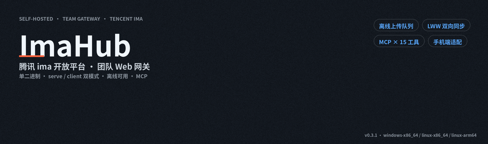
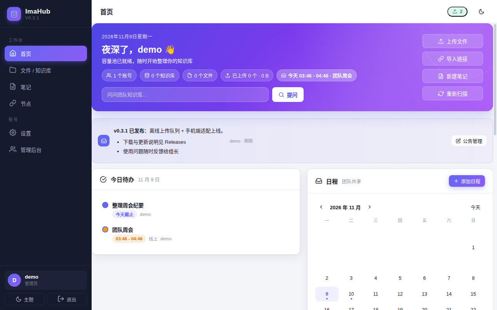
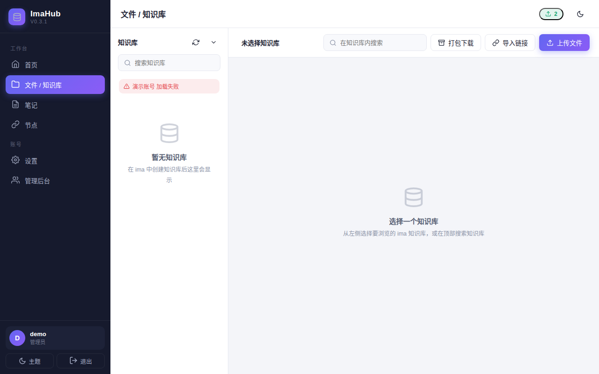
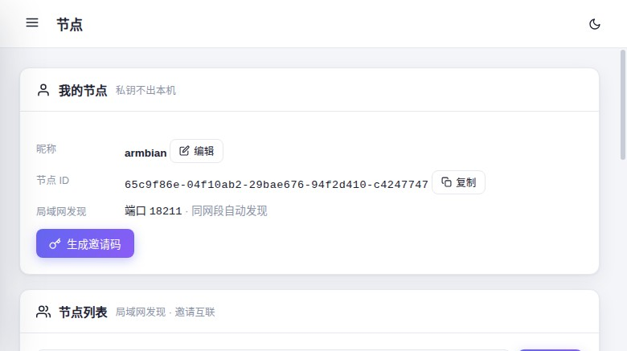
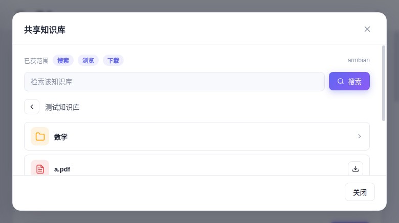
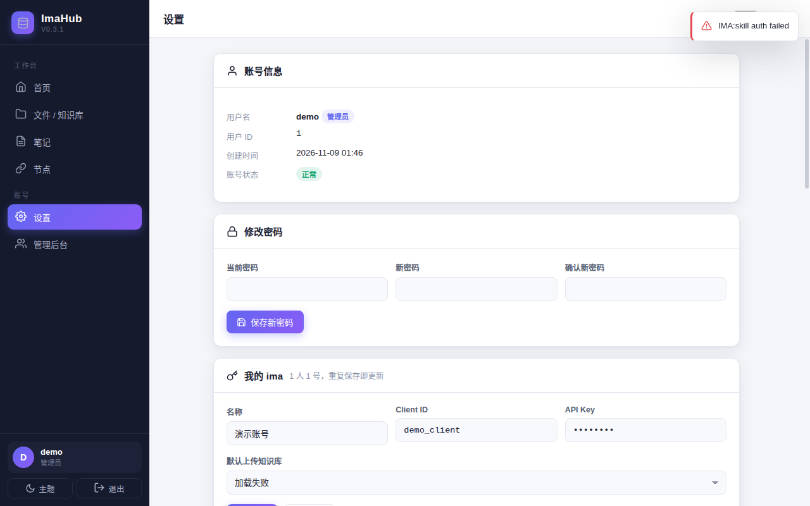
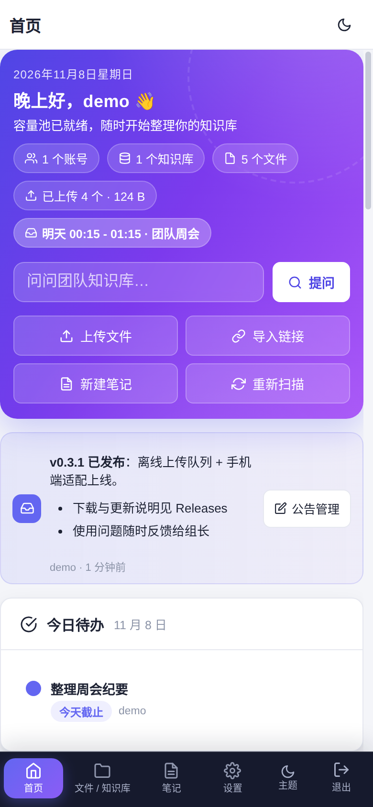
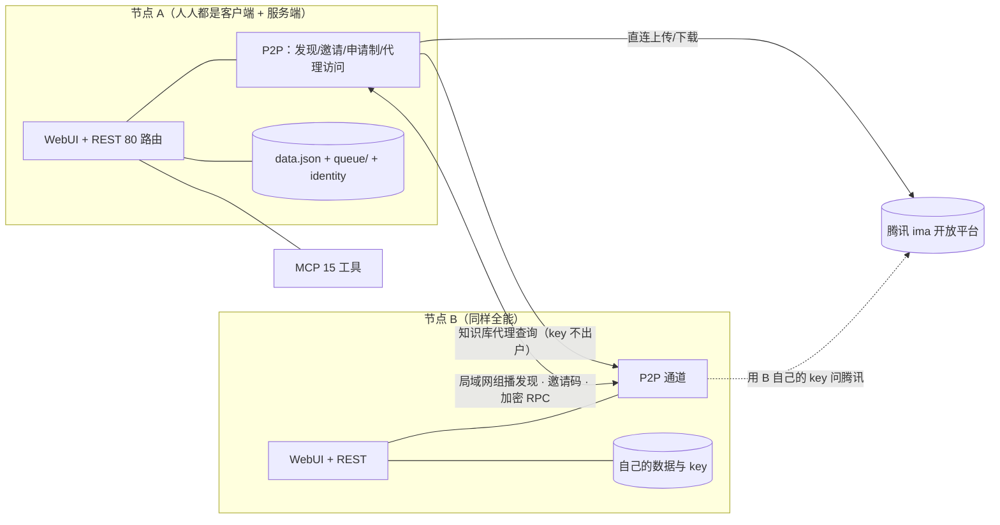
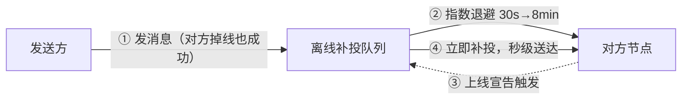
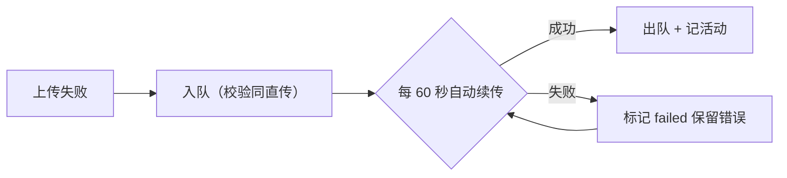

<p align="center"></p>

<p align="center">
  腾讯 <b>ima 开放平台</b>的团队 Web 网关：单个二进制起一个节点，浏览器里管理知识库——<br>
  上传下载、在线预览、笔记、RAG 问答、任务日程公告；<b>P2P 节点互联</b>：申请制共享他人知识库，<b>key 不出户</b>。<br>
  不用装 ima 客户端，不用腾讯 SDK。
</p>

<p align="center">
  
  
  
  
  
  
  
</p>

---

<p align="center">
  
</p>
<p align="center">
  
  
</p>
<p align="center">
  
  
</p>
<p align="center">
  <br>
  <sub>首页 · 文件 · 节点网络 · 共享知识库 · 设置 · 手机端——截图取自演示数据实例</sub>
</p>

## 它解决什么问题

| 层 | ImaHub 负责 | 换掉它意味着 |
| --- | --- | --- |
| 知识库入口 | 浏览器里管理知识库、笔记、问答 | 只能单人用 ima 客户端，无协作、无 API |
| 协作与管理 | 账号、任务、日程、公告、操作留痕 | 群里传文件，没有统一入口和记录 |
| 流量与离线 | 组员直连腾讯分担流量；断网排队补传 | 全部流量压一台服务器，断网即停摆 |
| **节点互联** | **P2P 申请制共享他人知识库，无中心服务器** | 只能把 key 交给别人，或整库拷来拷去 |

## 亮点

- 🖥️ **Windows 桌面版**：双击即用的原生窗口软件（WebView2），内嵌同款引擎——开着窗口就是一个全功能节点
- 🌐 **P2P 节点网络**：人人都是客户端、人人都是服务端——局域网自动发现 + 邀请码互联，无需中心服务器
- 🤝 **申请制共享**：向对方申请 search / browse / download 三档访问，可限知识库、可设有效期，批准可撤销；**你的 ima key 永不出你的机器**
- 📨 **掉线容错**：给掉线的节点发消息照样成功，指数退避重试，对方一上线立即补投（探针实测）
- 🗂️ **共享知识库**：经授权浏览/检索/下载对方知识库，文件夹下钻、全文检索、直链下载
- 🚀 **单二进制**：`serve` 全功能节点 / `client` 轻客户端，产物仅 8–10MB，拷贝即用
- 📴 **离线可用**：断网照常改任务日程（上线自动合并）、传文件进队列（每分钟自动续传）
- 🤖 **自带 MCP（15 工具）** + RAG 知识库问答，AI 客户端直接接入
- 📱 **手机端适配**：底部标签栏、触控 40px、模态近全屏，375px 实测不溢出

## 架构



```
main.go                 入口：serve / client 双模式、内嵌 WebUI、路由装配
internal/store/         JSON 持久化（用户/会话/队列/申请/墓碑，原子写）
internal/auth/          PBKDF2 口令哈希
internal/ima/           自写 ima 引擎（wiki/note 接口、COS 签名上传、压缩包解压）
internal/ask/           RAG 问答（跨账号检索 + OpenAI 兼容合成）
internal/peer/          P2P：Ed25519+X25519 身份、组播发现、邀请码、加密 RPC、离线补投
internal/api/           REST 80 路由（同步、上传队列、节点、访问申请、知识库代理）
internal/scan/          知识库后台扫描（统计快照，账号级并发）
internal/mcp/           MCP 服务（JSON-RPC / Streamable HTTP）
web/                    手写前端 SPA（零依赖，响应式 + 手机适配）
tools/                  README 数字口径、横幅生成、演示数据注入
scripts/                打包 / 冒烟 / 行为探针（含 P2P 双节点探针）
docs/                   API 契约、评审处置表、截图素材
```

## 节点网络（P2P）

**人人都是客户端，同时人人都是服务端**：每个节点跑同一个二进制，自带身份（Ed25519 签名 + X25519 加密，私钥永不出本机）、自带知识库、自带账号。

### 发现与互联（三层）

| 方式 | 场景 | 机制 |
| --- | --- | --- |
| 局域网自动发现 | 同网段即插即用 | UDP 组播 224.0.0.167:29820 宣告/应答，30s 一轮，防重放（单调时间戳） |
| 邀请码 | 跨网络 / 手动 | `IH1.` 开头 60 天有效，含身份+地址+签名，粘贴即互信 |
| 公网发现 | 跨 NAT（路线图） | 发现服务器 + 打洞/中继回退 |

### 访问申请制（共享即授权）

1. 申请方发起：选范围 **search（检索）/ browse（浏览）/ download（下载）** + 可限知识库 + 留言
2. 对方批准：可收窄范围、可设**有效期**、可设知识库白名单；拒绝/撤销即时生效
3. 掉线也不阻塞：申请消息进离线队列，对方上线自动补投

**key 不出户**：所有查询经对方节点用**它自己的 key** 问腾讯，结果加密回传——你的凭证永远不离开你的机器。

### 共享知识库

获授权后在「节点」页点「知识库」：KB 列表 → 文件夹下钻 → 全文检索（高亮摘要）→ 直链下载。越权即拒（含 **media↔知识库绑定**校验：拿 A 库的授权下不了 B 库的文件）。

### 掉线容错



- 发送永不阻塞、消息不丢；重试上限 200 次防僵尸占位
- 删除节点 = 打墓碑（宣告不复活）+ 清队列 + 清授权，一键干净

## 快速开始

**1. 下载**（[Releases](https://github.com/wohongshi/ima-hub/releases) 任选，静态编译无依赖）：

| 平台 | 产物 |
| --- | --- |
| **Windows x64（桌面版·推荐）** | `imahub-desktop_0.4.1_windows-x86_64.exe` —— 双击即用，原生窗口 |
| Windows x64（命令行） | `imahub_0.4.1_windows-x86_64.exe` |
| Linux x64 | `imahub_0.4.1_linux-x86_64` |
| Linux ARM64（树莓派 / 开发板） | `imahub_0.4.1_linux-arm64` |

> **桌面版**：Win11 自带 WebView2 直接跑；Win10 若提示缺运行时，装一次 [WebView2 Runtime](https://developer.microsoft.com/microsoft-edge/webview2/)（微软官方免费）。数据默认存 `%APPDATA%\ImaHub`，备份该目录=备份全部。

**2. 起节点**（每台机器各起一个，就是互联的两端）：

```bash
./imahub serve --addr :8090 --data ./data   # 或直接运行，默认 serve
```

**3. 互联**：浏览器打开 → 首次进入创建账号 → 「节点」页看局域网自动发现的邻居 → 或生成邀请码给对方粘贴 → 发访问申请。

**4. 绑定 ima**：「设置」页填自己的 Client ID / API Key（[ima.qq.com/agent-interface](https://ima.qq.com/agent-interface) 登录获取）。

> `imahub client` 轻客户端模式仍可用（组员端：直连 + 离线同步到中心服务），适合不参与 P2P 的旧部署。

### 参数

| 参数 | 默认 | 说明 |
| --- | --- | --- |
| `--addr` | serve `:8090` / client `127.0.0.1:8090` | 监听地址（**必须带固定端口**，P2P 直连要宣告可达端口） |
| `--data` | `./data` | 数据目录：data.json、identity.json、queue/（备份它=备份全部） |
| `--ima-base-url` | `https://ima.qq.com` | ima 开放平台地址（联调用） |
| `--server` | （空） | 客户端模式：预设服务端地址，页面里也能填 |

## 账号与权限

| 角色 | 能做什么 |
| --- | --- |
| 管理员（组长） | 全部功能 + 成员管理、代管成员 key、发公告、看全局统计 |
| 成员 | 绑定自己的 ima key（1 人 1 号）、上传下载预览、问答、任务日程、离线队列、MCP |
| 对等节点 | 无账号互通——凭**访问申请制**的授权范围访问你的知识库（search/browse/download） |

- **1 人 1 号**：设置页「我的 ima」自助绑定，重复保存即更新；管理员可在管理后台代管
- **P2P 共享**：节点间互相独立，无管理员概念；对方能做什么完全由你批的范围决定，随时撤销
- **会话**：30 天 HttpOnly Cookie；改密 / 管理员重置自动吊销旧会话；注册可开关

## 知识库与文件

- **上传**：浏览器多文件（带进度）→ 官方 create_media → COS 签名上传 → add_knowledge 全流程；同名检查 + 强制覆盖；网络失败自动转入**离线队列**
- **压缩包**：zip / 7z / rar 拖进来自动解压逐个入库；zip-slip 路径穿越拦截、解压炸弹限额（5000 文件 / 2GB / 单包 500MB）、失败明细逐条回报
- **下载**：单文件代理下载、多选批量打包 zip、整文件夹一键打包（浅层递归），打包总量 500MB 截断有说明
- **在线预览**：图片 / PDF / 文本 / Markdown / **音频**（mp3·m4a·wav·ogg），HTML / SVG 一律降级纯文本（防 XSS）
- **导入 URL**：网页 / 微信公众号文章一键导入（1–10 条批量）
- **单文件大小**：按官方规则内置校验（文本 10MB、图片 30MB、EPUB 50MB、其余 200MB）

## 离线上传队列

上传时代网络断、ima 不可用？文件不丢，自动排队补传：



- 配额 **20 个 / 2GB**，暂存 `data/queue/`；设置页队列面板可**重试 / 删除 / 全部续传**
- 顶栏角标显示待传数量，点击直达队列卡；失败条目**持续自动重试**（离线恢复后静默补传）
- 归属隔离：只能看到 / 操作自己的排队条目；压缩包暂不支持排队（请拆包入队）

## 服务端 ↔ 客户端同步

| 同步项 | 方向 | 机制 |
| --- | --- | --- |
| 任务 / 日程 | 双向 | **LWW**（UpdatedAt 决胜）+ 删除墓碑，离线可改 |
| 活动流水 | 客户端 → 服务端 | 增量游标（30s 重叠窗口）+ 按 ID 幂等去重 |
| ima key / 问答配置 | 服务端 → 客户端 | `since` 增量拉取；换服务端自动游标归零全量重拉 |
| 公告 | 服务端 → 客户端 | 只读下发，删除经墓碑同步清理 |

- 心跳 30 秒探活、2 分钟一轮同步、离线 → 恢复**立即补同步**
- since 游标使用**服务端时钟**（减 1s 重叠），两端时钟偏差不漏项
- 服务端掉线：客户端凭已分发的 key 继续直连（浏览/上传/下载/问答照常），队列自动攒着

## 知识库问答（RAG）

自然语言提问 → 跨账号跨知识库全文检索 → 可配 **OpenAI 兼容**模型合成回答并附引用来源（点击直达原文预览）。未配模型时降级为纯检索。设置页填 Base URL / 模型 / Key 即可启用；首页问答框与 MCP `ima_ask` 同款能力。

## MCP

端点 `http://<host>:8090/mcp`（JSON-RPC / Streamable HTTP），认证 `Authorization: Bearer <MCP令牌...自动生成、可轮换）。客户端配置示例：

```json
{
  "mcpServers": {
    "imahub": {
      "type": "streamableHttp",
      "url": "http://<host>:8090/mcp",
      "headers": { "Authorization": "Bearer <MCP令牌>" }
    }
  }
}
```

| 工具 | 说明 | 工具 | 说明 |
| --- | --- | --- | --- |
| `ima_ask` | 知识库智能问答（RAG） | `ima_list_notebooks` | 笔记本列表 |
| `ima_test` | 连通性测试 | `ima_list_notes` | 笔记列表 |
| `ima_search_knowledge_bases` | 搜索知识库 | `ima_search_notes` | 笔记搜索 |
| `ima_list_knowledge` | 知识库条目 | `ima_get_note` | 读取笔记 |
| `ima_search_knowledge` | 库内全文搜索 | `ima_create_note` | 新建笔记 |
| `ima_get_media_info` | 条目信息 | `ima_append_note` | 追加笔记内容 |
| `ima_download_media` | 下载 / 读取内容 | `ima_upload_file` | 上传文件 |
| `ima_import_urls` | 导入网页文章 | | |

所有工具支持可选 `account` 参数（账号 id 或归属用户名）指定 ima 账号。

## 任务 · 日程 · 公告

- **任务**：团队共享待办（状态 / 备注 / 截止日期 / 操作人留痕），首页「今日待办」聚合到期与逾期
- **日程**：团队共享，月历视图 + 即将到来 + 倒计时 + 全天事件，全员可增删改
- **公告**：管理员发布支持 Markdown（加粗 / 列表 / 链接），置顶首页，客户端只读同步

## 性能

| 优化点 | 做法 | 效果 |
| --- | --- | --- |
| 静态资源 | ETag + 304（must-revalidate） | 重复访问零传输，发版即生效 |
| 知识库扫描 / 问答检索 / 聚合浏览 | 逐账号并发 + 单账号超时隔离 | 多账号不互相拖，单账号挂不全局 |
| 节点 RPC | 连接复用（keep-alive 池）+ 代理环境保留 | 高频查询不再每次建连 |
| 知识库代理 | 跨账号并发聚合 + 下载并发闸（2） | 大文件并发放大不打爆内存 |
| 服务端↔客户端同步 | since 增量 + 活动流水游标 | 只传变更项，多客户端省流量 |

## 安全口径

- **口令**：PBKDF2-HMAC-SHA256（12 万轮）+ 常数时间比较；畸形哈希记录直接拒绝（防登录绕过）
- **会话**：HttpOnly Cookie、改密 / 重置吊销旧会话、TLS 下自动加 Secure
- **XSS**：输出全转义、Markdown 先转义再加工、inline 预览 MIME 白名单 + `CSP: sandbox` + `nosniff`
- **路径穿越**：zip-slip 拦截、排队文件名净化、MCP `file_path` 锁定上传目录
- **P2P 通道**：Ed25519 签名信封（身份绑定 + 防篡改）+ X25519(HKDF+AES-GCM) 加密封载 + nonce 去重 + 单调时间戳防宣告重放
- **P2P 授权**：申请制三档 + 知识库白名单 + media↔知识库绑定校验 + 有效期懒惰收敛；审批绑定对方身份，第三方伪造无效
- **限额**：请求体 2MB（JSON）/ 550MB（上传）、解压炸弹 5000 文件 / 2GB、打包 500MB 截断留痕、申请记录 2000 条上限
- **数据目录**含 ima 凭证、节点私钥与口令哈希——备份它=备份全部，**请勿公开分发**
- **密钥分发**为局域网团队信任模型（client 模式成员可取团队 key 直连）；公网部署请务必挂 **HTTPS 反代**

## 开发与测试

```bash
bash tools/readme_numbers.sh    # README 数字口径重算
go vet ./... && go test ./...   # 单测：LWW/墓碑、队列、解压、口令、P2P 身份/信封/授权
bash scripts/probe_kb.sh        # 知识库代理探针（22 断言，双节点 + mock）
bash scripts/probe_peer.sh      # P2P 发现/邀请/申请/补投探针（14 断言）
bash scripts/probe_queue.sh     # 离线队列探针（15 断言）
bash scripts/smoke.sh           # 全接口冒烟
bash scripts/build.sh           # 全平台打包（含 Windows 桌面版，自清 dist/，静态编译）
```

- **74 项行为探针**：P2P 发现/申请 14 + 知识库代理 22 + 离线队列 15 + 双端 E2E 13 + 安全/回滚 10（mock 栈跑，ALL_GREEN 才算过）
- **发布流程**：版本号改**两处**（`internal/api/api.go` 与 `internal/mcp/mcp.go`）→ 打包 → 验产物自报版本 → 发 Release
- 代码规模：Go 10,600+ 行 + 前端 6,300+ 行；23 个单测函数；REST 80 路由（口径见 `tools/readme_numbers.sh`）

<details>
<summary>设计取舍与限制</summary>

- **纯 Go 标准库 + 两个解压库**：无 CGO、无腾讯 SDK，单文件跨平台，升级=换一个二进制
- **JSON 文件存储**：团队规模数据量小，原子写入；备份即拷目录，不引入数据库运维
- **LWW + 墓碑**做离线合并：UpdatedAt 决胜 + 删除墓碑压旧更新；极端时钟漂移下取「最后写入者」语义，不做 CRDT
- **ima 开放平台无「删除条目」接口**，故不提供删除（请在 ima 客户端里删）
- 音频最长 2 小时（官方限制）；压缩包暂不支持进离线队列
- 公告单向同步（客户端只读），避免公告被组员误改
- P2P 经节点代理下载单文件上限 32MB（更大走各自的 ima 直连）；公网发现/中继在路线图

</details>

<details>
<summary>常见问题</summary>

- **端口被占用 / 启动失败**：换 `--addr`，如 `--addr :9090`
- **忘记管理员密码**：无找回机制（只存哈希）；让管理员在后台重置，或移走 `data/` 重新初始化
- **对方看不到我的节点？** 同网段等 30s 宣告；跨网络用邀请码（「节点」页生成/粘贴）
- **申请发出去对方没收到？** 对方掉线也没关系——消息自动排队补投，上线即达（列表可见待投递数）
- **客户端离线时哪些功能可用？** 浏览/上传/下载/问答（直连 + 已分发 key）、任务日程编辑、上传排队；公告为缓存只读
- **怎么升级？** 停进程 → 换新二进制 → 起进程（数据目录不动）；浏览器强制刷新一次
- **手机上音频放不了？** iOS Safari 对 mp3 / m4a 兼容良好，wav 建议转 mp3
- **MCP 连不上？** 确认令牌在设置页已生成、`Authorization: Bearer` 头正确、反代未拦截 `/mcp`

</details>

## 文档

- [REST 与同步契约](docs/api-contract.md)——全部端点、权限矩阵、同步协议
- [代码评审处置表（P2P 轮）](docs/ocr-review-20261109.md)——74 条评审意见的逐条处置记录
- [代码评审处置表（0.1.x 轮）](docs/ocr-review-20261107.md)——95 条评审意见的逐条处置记录

---

未选择开源许可证（默认保留所有权利），供团队内部使用。
