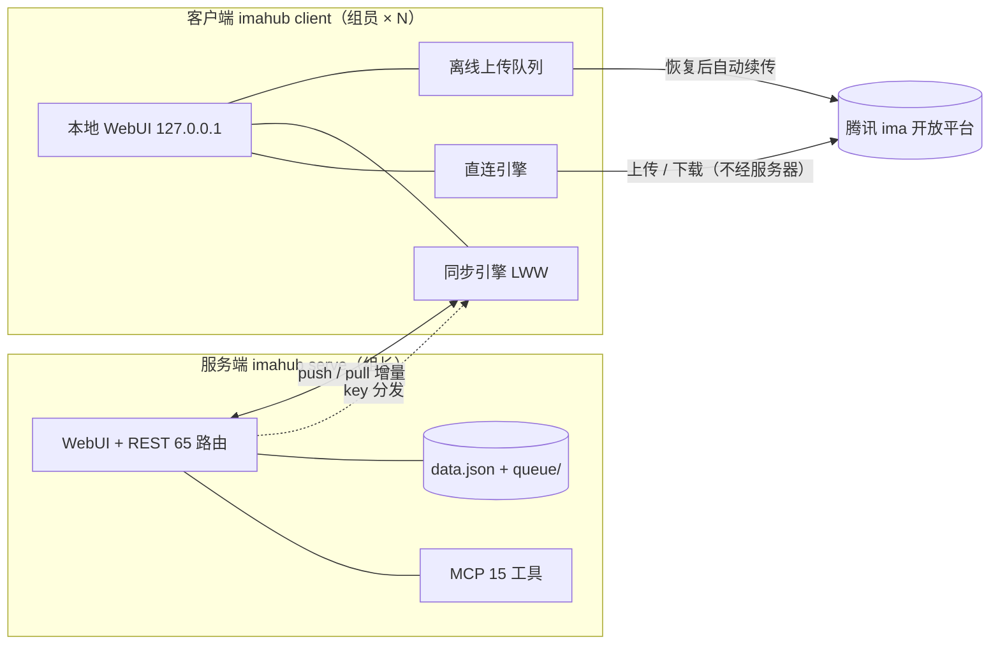
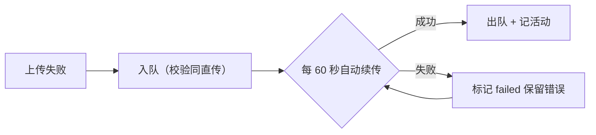

<p align="center"></p>

<p align="center">
  腾讯 <b>ima 开放平台</b>的团队 Web 网关：单个二进制起一个网关，浏览器里管理团队知识库——<br>
  上传下载、在线预览、笔记、RAG 问答、任务日程公告；组员端<b>直连腾讯</b>分担流量，<b>断网也能用</b>。<br>
  不用装 ima 客户端，不用腾讯 SDK。
</p>

<p align="center">
  
  
  
  
  
  
</p>

---

<p align="center">
  
</p>
<p align="center">
  
  
</p>
<p align="center">
  <br>
  <sub>首页仪表盘 · 文件/知识库 · 设置 · 手机端（底部标签栏）——截图取自 0.3.1 演示数据</sub>
</p>

## 它解决什么问题

| 层 | ImaHub 负责 | 换掉它意味着 |
| --- | --- | --- |
| 知识库入口 | 浏览器里管理团队知识库、笔记、问答 | 只能单人用 ima 客户端，无团队协作、无 API |
| 协作与管理 | 成员/账号、任务、日程、公告、操作留痕 | 群里传文件，没有统一入口和记录 |
| 流量与离线 | 组员直连腾讯分担流量；断网排队补传 | 全部流量压一台服务器，断网即停摆 |

## 亮点

- 🚀 **单二进制双模式**：`serve`（全功能服务端）/ `client`（组员端），产物仅 8–10MB，拷贝即用
- 📴 **离线可用**：断网照常改任务日程（上线自动合并）、传文件进队列（每分钟自动续传）
- 🔑 **1 人 1 号**：成员自填自己的 ima key；团队内容免授权取用直连
- 📱 **手机端适配**：底部标签栏、触控 40px、模态近全屏，375px 实测不溢出
- 🤖 **自带 MCP（15 工具）** + RAG 知识库问答，AI 客户端直接接入
- 📦 **压缩包直接拖**：zip / 7z / rar 自动解压逐个入库，带路径穿越与解压炸弹防护

## 架构



```
main.go                 入口：serve / client 双模式、内嵌 WebUI、路由装配
internal/store/         JSON 持久化（用户/会话/队列/LWW 墓碑，原子写）
internal/auth/          PBKDF2 口令哈希
internal/ima/           自写 ima 引擎（wiki/note 接口、COS 签名上传、压缩包解压）
internal/ask/           RAG 问答（跨账号检索 + OpenAI 兼容合成）
internal/api/           REST 65 路由（含同步、上传队列、客户端链路）
internal/scan/          知识库后台扫描（统计快照，账号级并发）
internal/mcp/           MCP 服务（JSON-RPC / Streamable HTTP）
web/                    手写前端 SPA（零依赖，响应式 + 手机适配）
tools/                  README 数字口径、横幅生成、演示数据注入
scripts/                打包 / 冒烟 / 行为探针
docs/                   API 契约、评审处置表、截图素材
```

## 快速开始

**1. 下载**（[Releases](https://github.com/wohongshi/ima-hub/releases) 三平台任选，静态编译无依赖）：

| 平台 | 产物 |
| --- | --- |
| Windows x64 | `imahub_0.3.1_windows-x86_64.exe` |
| Linux x64 | `imahub_0.3.1_linux-x86_64` |
| Linux ARM64（树莓派 / 开发板） | `imahub_0.3.1_linux-arm64` |

**2. 组长（服务端）**：

```bash
./imahub serve --addr :8090 --data ./data     # 或直接运行，默认 serve
```

**3. 组员（客户端）**：

```bash
./imahub client                                # 本地 WebUI：http://127.0.0.1:8090
./imahub client --server 192.168.3.10:8090     # 可预设服务端地址
```

**4. 上手三步**：浏览器打开 → 首次进入创建管理员 → 「设置」绑定自己的 ima 凭证 → 邀请组员连服务端。

获取 ima 凭证：打开 [ima.qq.com/agent-interface](https://ima.qq.com/agent-interface) 登录（QQ/微信）→「获取 API Key」→ 复制 **Client ID** 与 **API Key** 填进设置页。

### 参数

| 参数 | 默认 | 说明 |
| --- | --- | --- |
| `--addr` | serve `:8090` / client `127.0.0.1:8090` | 监听地址（客户端默认只听本机） |
| `--data` | `./data` | 数据目录：data.json、tmp/、queue/（备份它=备份全部） |
| `--ima-base-url` | `https://ima.qq.com` | ima 开放平台地址（联调用） |
| `--server` | （空） | 客户端模式：预设服务端地址，页面里也能填 |

## 账号与权限

| 角色 | 能做什么 |
| --- | --- |
| 管理员（组长） | 全部功能 + 成员管理、代管成员 key、发公告、看全局统计 |
| 成员 | 绑定自己的 ima key（1 人 1 号）、上传下载预览、问答、任务日程、离线队列、MCP |

- **1 人 1 号**：设置页「我的 ima」自助绑定，重复保存即更新；管理员可在管理后台代管
- **key 分发**：团队内容（他人账号的库）免授权取用——客户端自动拿到全部 key 本地直连（局域网团队信任模型）
- **会话**：30 天 HttpOnly Cookie；改密 / 管理员重置自动吊销旧会话；注册可开关

## 知识库与文件

- **上传**：浏览器多文件（带进度）→ 官方 create_media → COS 签名上传 → add_knowledge 全流程；同名检查 + 强制覆盖；网络失败自动转入**离线队列**
- **压缩包**：zip / 7z / rar 拖进来自动解压逐个入库；zip-slip 路径穿越拦截、解压炸弹限额（5000 文件 / 2GB / 单包 500MB）、失败明细逐条回报
- **下载**：单文件代理下载、多选批量打包 zip、整文件夹一键打包（浅层递归），打包总量 500MB 截断有说明
- **在线预览**：图片 / PDF / 文本 / Markdown / **音频**（mp3·m4a·wav·ogg），HTML / SVG 一律降级纯文本（防 XSS）
- **导入 URL**：网页 / 微信公众号文章一键导入（1–10 条批量）
- **单文件大小**：按官方规则内置校验（文本 10MB、图片 30MB、EPUB 50MB、其余 200MB）

## 离线上传队列

上传时代网络断、ima 不可用？文件不丢，自动排队补传：



- 配额 **20 个 / 2GB**，暂存 `data/queue/`；设置页队列面板可**重试 / 删除 / 全部续传**
- 顶栏角标显示待传数量，点击直达队列卡；失败条目**持续自动重试**（离线恢复后静默补传）
- 归属隔离：只能看到 / 操作自己的排队条目；压缩包暂不支持排队（请拆包入队）

## 服务端 ↔ 客户端同步

| 同步项 | 方向 | 机制 |
| --- | --- | --- |
| 任务 / 日程 | 双向 | **LWW**（UpdatedAt 决胜）+ 删除墓碑，离线可改 |
| 活动流水 | 客户端 → 服务端 | 增量游标（30s 重叠窗口）+ 按 ID 幂等去重 |
| ima key / 问答配置 | 服务端 → 客户端 | `since` 增量拉取；换服务端自动游标归零全量重拉 |
| 公告 | 服务端 → 客户端 | 只读下发，删除经墓碑同步清理 |

- 心跳 30 秒探活、2 分钟一轮同步、离线 → 恢复**立即补同步**
- since 游标使用**服务端时钟**（减 1s 重叠），两端时钟偏差不漏项
- 服务端掉线：客户端凭已分发的 key 继续直连（浏览/上传/下载/问答照常），队列自动攒着

## 知识库问答（RAG）

自然语言提问 → 跨账号跨知识库全文检索 → 可配 **OpenAI 兼容**模型合成回答并附引用来源（点击直达原文预览）。未配模型时降级为纯检索。设置页填 Base URL / 模型 / Key 即可启用；首页问答框与 MCP `ima_ask` 同款能力。

## MCP

端点 `http://<host>:8090/mcp`（JSON-RPC / Streamable HTTP），认证 `Authorization: Bearer <MCP令牌>`（设置页生成/重置），按用户隔离凭证：

```json
{
  "mcpServers": {
    "imahub": {
      "type": "streamableHttp",
      "url": "http://<host>:8090/mcp",
      "headers": { "Authorization": "Bearer <MCP令牌>" }
    }
  }
}
```

| 工具 | 说明 | 工具 | 说明 |
| --- | --- | --- | --- |
| `ima_ask` | 知识库智能问答（RAG） | `ima_list_notebooks` | 笔记本列表 |
| `ima_test` | 连通性测试 | `ima_list_notes` | 笔记列表 |
| `ima_search_knowledge_bases` | 搜索知识库 | `ima_search_notes` | 笔记搜索 |
| `ima_list_knowledge` | 知识库条目 | `ima_get_note` | 读取笔记 |
| `ima_search_knowledge` | 库内全文搜索 | `ima_create_note` | 新建笔记 |
| `ima_get_media_info` | 条目信息 | `ima_append_note` | 追加笔记内容 |
| `ima_download_media` | 下载 / 读取内容 | `ima_upload_file` | 上传文件 |
| `ima_import_urls` | 导入网页文章 | | |

所有工具支持可选 `account` 参数（账号 id 或归属用户名）指定 ima 账号。

## 任务 · 日程 · 公告

- **任务**：团队共享待办（状态 / 备注 / 截止日期 / 操作人留痕），首页「今日待办」聚合到期与逾期
- **日程**：团队共享，月历视图 + 即将到来 + 倒计时 + 全天事件，全员可增删改
- **公告**：管理员发布支持 Markdown（加粗 / 列表 / 链接），置顶首页，客户端只读同步

## 性能

| 优化点 | 做法 | 效果 |
| --- | --- | --- |
| 静态资源 | ETag + 304（must-revalidate） | 重复访问零传输，发版即生效 |
| 知识库扫描 / 问答检索 / 聚合浏览 | 逐账号并发 + 单账号超时隔离 | 多账号不互相拖，单账号挂不全局 |
| 服务端↔客户端同步 | since 增量 + 活动流水游标 | 只传变更项，多客户端省流量 |

## 安全口径

- **口令**：PBKDF2-HMAC-SHA256（12 万轮）+ 常数时间比较；畸形哈希记录直接拒绝（防登录绕过）
- **会话**：HttpOnly Cookie、改密 / 重置吊销旧会话、TLS 下自动加 Secure
- **XSS**：输出全转义、Markdown 先转义再加工、inline 预览 MIME 白名单 + `CSP: sandbox` + `nosniff`
- **路径穿越**：zip-slip 拦截、排队文件名净化、MCP `file_path` 锁定上传目录
- **限额**：请求体 2MB（JSON）/ 550MB（上传）、解压炸弹 5000 文件 / 2GB、打包 500MB 截断留痕
- **数据目录**含 ima 凭证与口令哈希——备份它=备份全部，**请勿公开分发**
- **密钥分发**为局域网团队信任模型（成员可取团队 key 直连）；公网部署请务必挂 **HTTPS 反代**

## 开发与测试

```bash
bash tools/readme_numbers.sh    # README 数字口径重算
go vet ./... && go test ./...   # 单测：LWW/墓碑、队列、解压、口令
bash scripts/probe_queue.sh     # 离线队列探针（15 断言）
bash scripts/smoke.sh           # 全接口冒烟
bash scripts/build.sh           # 三平台打包（自清 dist/，静态编译）
```

- **38 项行为探针**：安全 / 回滚 10 + 双端 E2E 13 + 离线队列 15（mock 栈跑，ALL_GREEN 才算过）
- **发布流程**：版本号改**两处**（`internal/api/api.go` 与 `internal/mcp/mcp.go`）→ 打包 → 验产物自报版本 → 发 Release
- 代码规模：Go 7,723 行 + 前端 5,428 行；14 个单测函数；REST 65 路由（口径见 `tools/readme_numbers.sh`）

<details>
<summary>设计取舍与限制</summary>

- **纯 Go 标准库 + 两个解压库**：无 CGO、无腾讯 SDK，单文件跨平台，升级=换一个二进制
- **JSON 文件存储**：团队规模数据量小，原子写入；备份即拷目录，不引入数据库运维
- **LWW + 墓碑**做离线合并：UpdatedAt 决胜 + 删除墓碑压旧更新；极端时钟漂移下取「最后写入者」语义，不做 CRDT
- **ima 开放平台无「删除条目」接口**，故不提供删除（请在 ima 客户端里删）
- 音频最长 2 小时（官方限制）；压缩包暂不支持进离线队列
- 公告单向同步（客户端只读），避免公告被组员误改

</details>

<details>
<summary>常见问题</summary>

- **端口被占用 / 启动失败**：换 `--addr`，如 `--addr :9090`
- **忘记管理员密码**：无找回机制（只存哈希）；让管理员在后台重置，或移走 `data/` 重新初始化
- **客户端离线时哪些功能可用？** 浏览/上传/下载/问答（直连 + 已分发 key）、任务日程编辑、上传排队；公告为缓存只读
- **怎么升级？** 停进程 → 换新二进制 → 起进程（数据目录不动）；浏览器强制刷新一次
- **手机上音频放不了？** iOS Safari 对 mp3 / m4a 兼容良好，wav 建议转 mp3
- **MCP 连不上？** 确认令牌在设置页已生成、`Authorization: Bearer` 头正确、反代未拦截 `/mcp`

</details>

## 文档

- [REST 与同步契约](docs/api-contract.md)——全部端点、权限矩阵、同步协议
- [代码评审处置表](docs/ocr-review-20261107.md)——两轮 ocr 评审意见的逐条处置记录

---

未选择开源许可证（默认保留所有权利），供团队内部使用。
